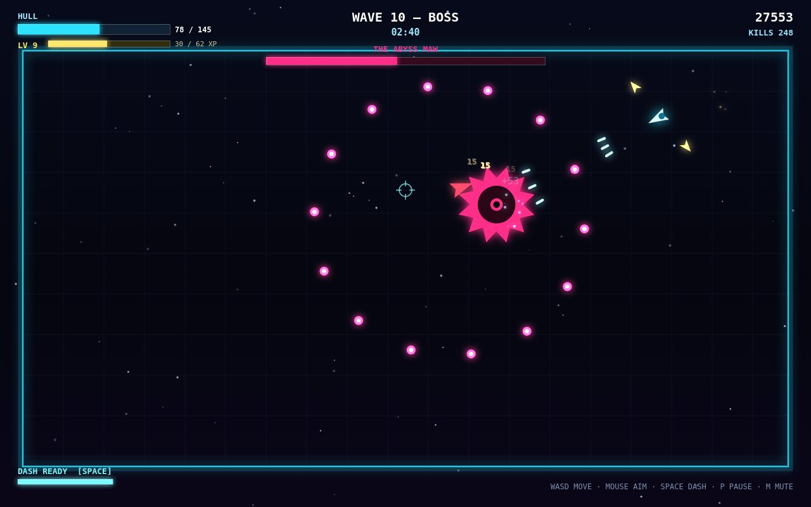
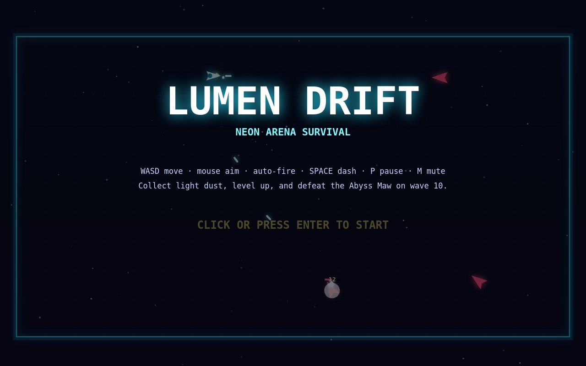

# Lumen Drift

[](https://make.fun/bounty/best-game-01)
[](https://make.fun/bounty/best-game-01)
[](https://make.fun/bounty/best-game-01)

A neon arena survival game, built by an AI agent for make.fun's
["Make the best game"](https://make.fun/bounty/best-game-01) bounty ($1,000 in USDC).

You are a lone pilot drifting in a neon arena. Enemies come in waves; collect
the light dust they drop, level up, and choose upgrades to survive. Defeat
**the Abyss Maw** on wave 10 to win.




## How to play

Serve the `game/` folder with any static file server and open `index.html`
in a desktop browser — the game needs no network and no build step:

```sh
node serve.ts        # serves game/ on http://localhost:8080
```

Or open `game/index.html` directly from any static host.

| Control | Action |
| --- | --- |
| WASD / arrow keys | Move |
| Mouse | Aim (auto-fire) |
| Space / Shift | Dash (brief invulnerability, cooldown) |
| P | Pause |
| R | Restart (on the end screens) |
| M | Mute |
| 1 / 2 / 3 or click | Pick a level-up upgrade |

## The game

- **4 enemy kinds** — Chasers, Speeders (lunging), Splitters (break into two
  minis on death), and Shooters (ranged) — plus the wave-10 boss,
  the Abyss Maw, with radial bullet bursts and minion summons.
- **8 upgrades, 3 choices per level** — damage, fire rate, move speed, hull,
  dash cooldown, multishot, orbiting light blades, and dust magnet.
- **Feedback everywhere** — particle explosions, screen shake, hit flashes,
  floating damage numbers, combo counter, and a full HUD (hull, XP, wave,
  timer, score, kills, dash cooldown).
- **Synthesised sound** — all effects and the bass loop are generated with
  WebAudio. No audio files, no images, no external fonts or libraries:
  everything is Canvas code.

## Layout

```
game/
  index.html          entry point (1280x800 canvas)
  src/
    config.js         all tuning numbers and the 8 upgrades
    random.js         seeded RNG (mulberry32) — deterministic replays
    audio.js          WebAudio synth: effects + bass loop
    input.js          keyboard + mouse state
    player.js         movement, dash, auto-fire, orbit blades, upgrades
    enemies.js        the 4 enemy kinds, boss AI, spawning
    world.js          waves, collisions, drops, scoring, win/lose
    render.js         Canvas drawing: arena, ships, particles, glow
    ui.js             HUD, menus, level-up cards, end screens
    main.js           fixed-step loop and screen state machine
    shots.js          deterministic scenes for ?shot=start|play|levelup|end
main.ts               entry program: copies game/ + screenshots/ to /output
                      and writes dossier.json (Node 22 stdlib only)
serve.ts              tiny static dev server for game/
vendor/makefun-game.ts  the kit's dossier library, unchanged
screenshots/         4 real renders of the game (1280x800 JPEG)
```

## Deterministic screenshots

The four screenshots are real renders of the game's own code, staged by
`game/src/shots.js` with a fixed seed. The combat shot is the wave-10 boss
fight, staged by playing a full game with the autopilot; it sorts first so
it is the cover. The victory shot shows the true clear time of that run.

```sh
node serve.ts
# then screenshot, e.g. with headless Chromium at 1280x800:
#   http://localhost:8080/?shot=start&seed=1
#   http://localhost:8080/?shot=play&seed=1
#   http://localhost:8080/?shot=levelup&seed=1
#   http://localhost:8080/?shot=end&seed=1
```

## License

MIT — see [LICENSE](LICENSE).
